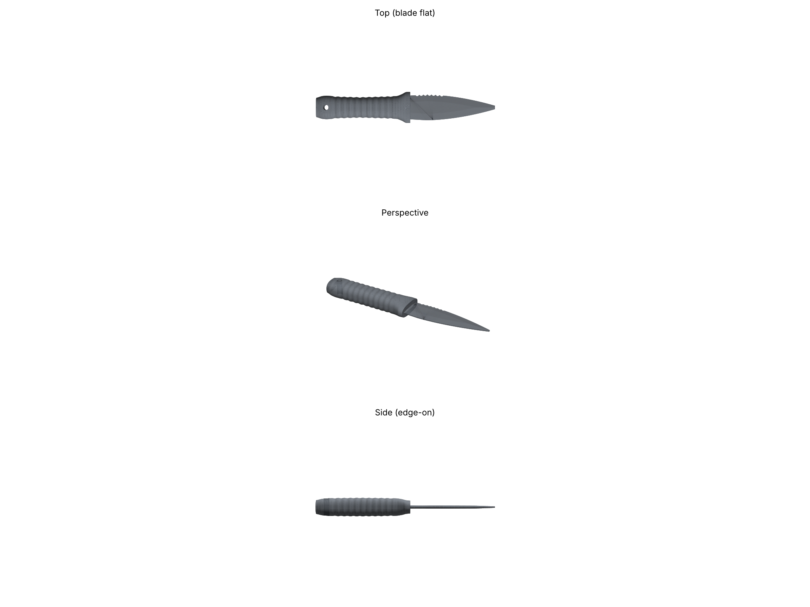

# THE FINALS Dagger Prop

A parametric, 3D-printable prop of the dagger from THE FINALS. I found no dedicated model on Cults3D, MakerWorld, Printables or Thingiverse, so I modelled it from the **Fox Knives FX-647 S (Elementum dagger)**. THE FINALS wiki says the in-game dagger resembles it, but the developers have not confirmed that.



## Reference dimensions (FX-647 S retailer specs)

| Spec | Value | Model |
|---|---|---|
| Blade length | 100 mm | 100 mm |
| Overall length | 200 mm (Knivesandtools), 206 mm (Stoeger) | 200 mm |
| Handle length | 100 mm | 103 mm (includes the guard) |
| Blade height | 30 mm | 28 mm blade, 34 mm guard |
| Blade thickness | 3 mm | 3 mm |
| Edge | plain + serrated | double edge, serrated on one edge near the guard |

The handle cross-section, guard and grip rings are estimated from photos. Retailers don't publish those dimensions.

## Safety

This is a **prop**. The edges are modelled blunt (`EDGE_THICKNESS = 1.0` mm) and the tip is rounded (`TIP_RADIUS`). Keep it that way. Check your local rules before carrying it to events.

## Files

- `stl/dagger_full.stl` prints in one piece (200 x 34 x 20.4 mm).
- `stl/dagger_blade.stl` is the blade with a 60 x 12 x 3 mm tang.
- `stl/dagger_handle.stl` is the handle, with a tang slot (0.15 mm clearance per side). Use it if you want to paint the blade and handle separately, then glue them together.
- `dagger.py` is the parametric model. Edit the ALL_CAPS constants at the top and re-run it.
- `render_preview.py` regenerates `images/preview.png`.

```bash
pip install -r requirements.txt
python3 dagger.py
python3 render_preview.py
```

## Printing (Anycubic Photon M3 Max)

- Every part fits the M3 Max build volume (298 x 164 x 300 mm). Stand the part vertically at about a 15-30° tilt, with the pommel toward the plate. Put light supports on the guard and pommel, and keep supports off the blade flats.
- The handle is solid (about 37 cm³). Hollow it in the slicer (2.5-3 mm wall) to save resin. Add drain holes where the slot or lanyard hole can hide them.
- Test-fit the tang in the slot. If it's too tight or too loose for your resin, change `TANG_CLEARANCE`.
- For a tougher blade, use a tough or ABS-like resin, or mix in some flexible resin.

## Notes

See `docs/handoff.md` for the original research notes and the resin printer ventilation plan.
