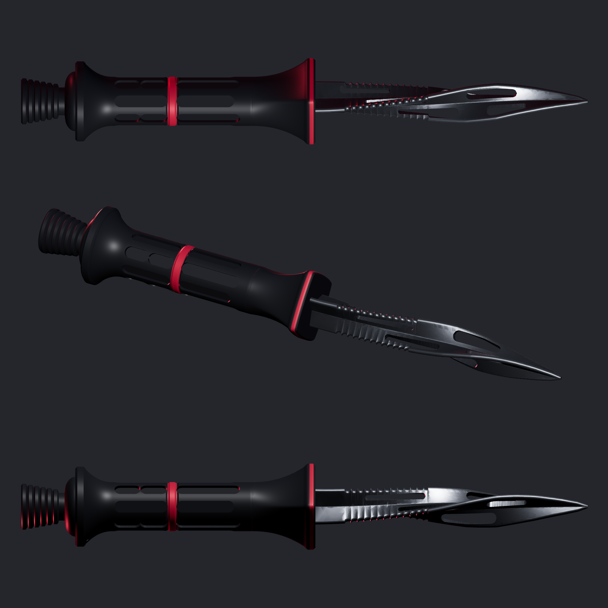
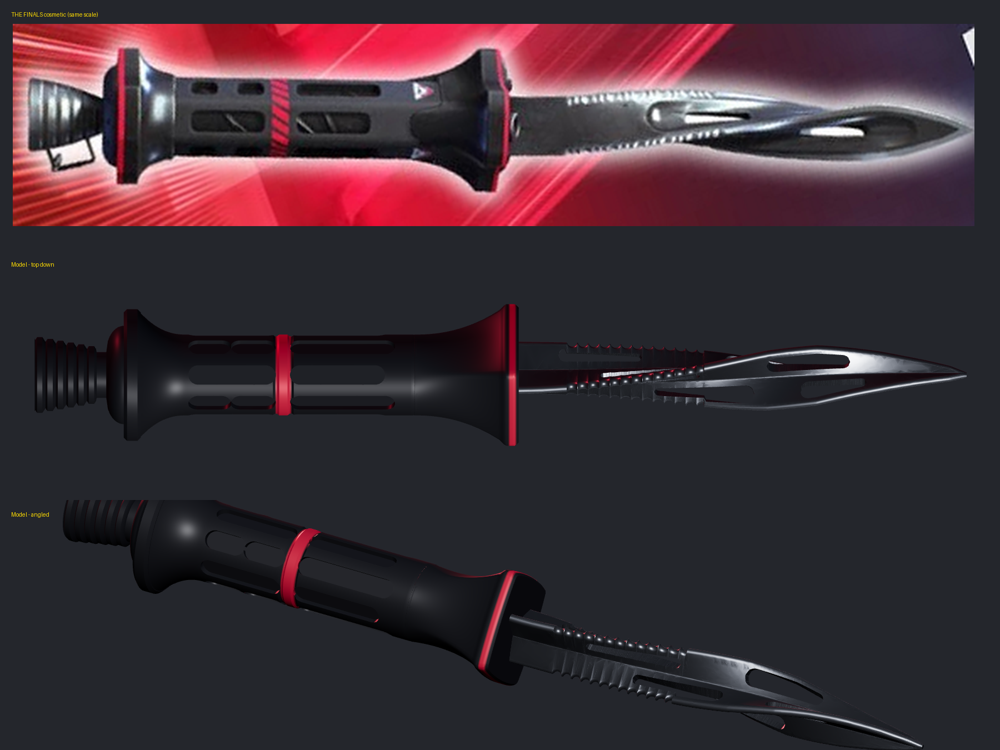

# THE FINALS Dagger Prop: Recoilless Blade

A parametric, 3D-printable prop of the THE FINALS dagger in its **Recoilless Blade** skin. Every dimension was measured off the in-game skin showcase image, at 0.405 mm per image pixel. The details were checked against the official skin render on [THE FINALS Wiki](https://www.thefinals.wiki/wiki/Dagger) and in-game footage.



The comparison below puts the cosmetic image (top) at the same scale as the model:



## Features

- **Blade:** 108 mm long, a three-edged corkscrew from the guard to the tip.
  - Three fins, 120° apart, twist about a third of a turn (120°, eased in and out) along the blade. They have thick, rounded 2 mm edges and a 4.6 mm core at the guard.
  - Serrations are cut into all three fin edges from 12 to 45 mm out from the guard.
  - Each fin has two see-through windows, staggered from fin to fin like the skin's (`FIN_WINDOWS`).
  - Change `CORKSCREW_TWIST` in `dagger.py` for a tighter or looser twist.
- **Handle:** a slim recoilless-rifle tube, 116 mm long with a 19.4 mm grip.
  - The front guard has four corners: a diamond-shaped flange, 34 mm across the corners, that flares down into the round grip.
  - A concave bell flares out to the round rear flange (32 mm).
  - Eight recessed windows sit in alternating rows, and two grooves mark out the red band.
  - A domed cap and a ribbed venturi nozzle form the pommel.
- **Lanyard bail:** two small holes through the rear flange take a bent wire loop, like the one on the in-game skin.
- **Overall length:** about 222 mm. Change `SCALE` in `dagger.py` to resize the whole prop.

## Safety

This is a **prop**. The edges are modelled blunt (`EDGE_THICKNESS = 1.0` mm) and the tip is rounded (`TIP_RADIUS`). Keep it that way. Check your local rules before carrying it to events.

## Files

- `stl/dagger_full.stl` prints in one piece.
- `stl/dagger_blade.stl` is the blade with a 50 mm Y-shaped key tang. The key is the blade's own base cross-section trimmed down, so it stays hidden and can't spin in the handle.
- `stl/dagger_handle.stl` is the handle, with a tang slot (0.15 mm clearance per side). Print the two parts separately to make painting easier, then glue them together.
- `dagger.py` is the parametric model. Edit the ALL_CAPS constants at the top and re-run it.
- `render_preview.py` writes a quick matplotlib preview to `images/preview.png`.

```bash
pip install -r requirements.txt
python3 dagger.py
python3 render_preview.py
```

## Painting (to match the skin)

- **Blade:** gunmetal or dark chrome. Use a metallic silver drybrush on the serrations and fin edges.
- **Handle:** satin black. Paint red on the band between the two grooves and on the edges of both flanges. A dark red ring on each nozzle rib adds depth.
- **Decals:** add THE FINALS triangle logo on the front bell, and diagonal black stripes over the red band, as decals or masked paint.

## Printing (Anycubic Photon M3 Max)

- Every part fits the M3 Max build volume (298 x 164 x 300 mm).
- **Handle:** print it standing on the nozzle end, tilted about 10-15°. The grip is slim, so print it solid (about 37 cm³ of resin), or hollow it with a wall of at least 3 mm.
- **Blade:** print it tip-up at 15-30°. Put supports on the tang. If the fins need support, use light supports on the fin roots only.
- **Resin:** the thin webs beside the fin windows are the most fragile parts, so use a tough or ABS-like resin for the blade.
- **Tang fit:** test-fit the tang in the slot. If it's too tight or too loose for your resin, change `TANG_CLEARANCE`.

## Notes

See `docs/handoff.md` for the original research notes and the resin printer ventilation plan.
